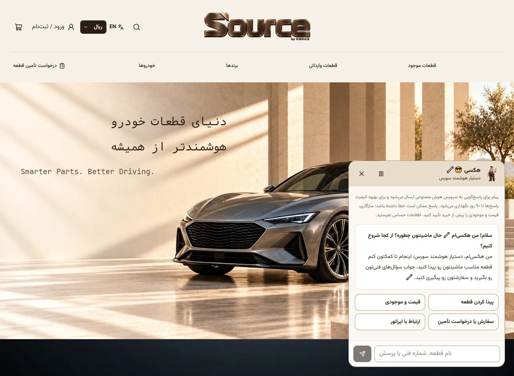
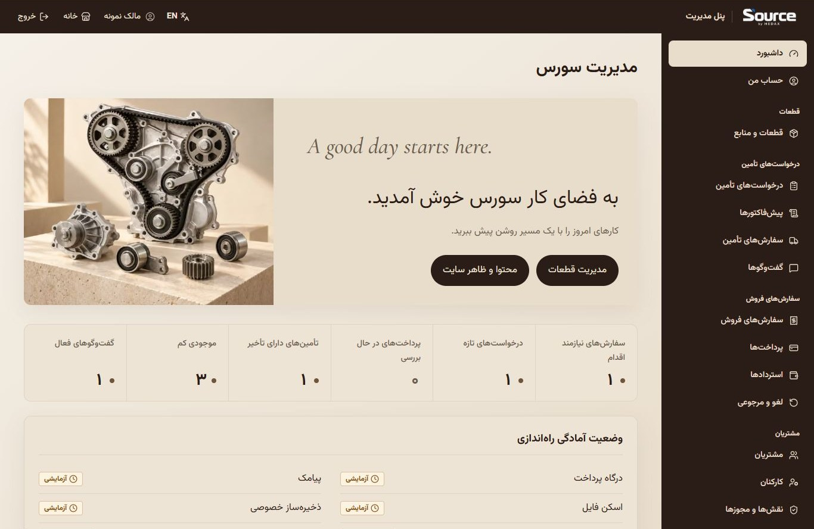

<div align="center">


### فروش قطعات خودرو و تأمین سفارشی، در یک مسیر پیوسته.

[English](README.md) · [سایت](https://sourcebyhedax.ir/fa) · [معماری](docs/ARCHITECTURE.md) · [فهرست راهنماها](docs/README.md) · [وضعیت راه‌اندازی](docs/DEPLOYMENT_STATUS.md)

</div>

<div dir="rtl">

سورس یک فروشگاه اینترنتی قطعات خودرو است که به خدمت تأمین سفارشی وصل شده. مشتری قطعهٔ موجود را می‌خرد، یا قطعه‌ای را که موجود نیست درخواست می‌کند؛ کارشناس با پیش‌فاکتور نسخه‌دار پاسخ می‌دهد و همان درخواست تا تأمین، پرداخت و تحویل در همین سامانه پیش می‌رود. رابط فارسی (راست‌به‌چپ) و انگلیسی است و وب، API و کارهای پس‌زمینه از یک مجموعه قواعد تجاری استفاده می‌کنند.

**وضعیت: پیش از راه‌اندازی فروش.** سایت روی [sourcebyhedax.ir](https://sourcebyhedax.ir/fa) در دسترس است. ورود مشتری با پیامک و پرداخت آنلاین هنوز وصل نیست و فروشگاه سفارش واقعی نمی‌گیرد. کارهای باقی‌مانده در [وضعیت راه‌اندازی](docs/DEPLOYMENT_STATUS.md) آمده است.

</div>

<p align="center">
  
  
  <br><sub>فروشگاه با دستیار هکسی و داشبورد پنل مدیریت (دادهٔ نمایشی).</sub>
</p>

<div dir="rtl">

## امکانات

| بخش | امکانات |
| --- | --- |
| فروشگاه | کاتالوگ بر اساس دسته، برند و خودرو؛ جست‌وجوی فارسی؛ سبد، رزرو موجودی، تکمیل خرید و پیگیری سفارش |
| تأمین سفارشی | درخواست برای هر برند، گفت‌وگو با پیوست فایل، پیش‌فاکتور نسخه‌دار، پذیرش و مراحل تأمین |
| پیش‌فاکتور | PDF فارسی و انگلیسی، تسویهٔ ریالی با قیمت مرجع درهم |
| هکسی، دستیار فروشگاه | دستیار متنی دوزبانه که فقط از کاتالوگ زنده پاسخ می‌دهد: شمارهٔ فنی، قیمت، موجودی و کاربرد ثبت‌شده در خودرو. سقف روزانهٔ هزینه و تعداد درخواست؛ کارکنان گفت‌وگوها را می‌بینند و می‌توانند خودشان پاسخ دهند |
| پیام‌رسان | بات بله برای جست‌وجوی قطعه |
| مدیریت | نقش‌ها و مجوزهای کارکنان، ورود دومرحله‌ای اجباری برای کارکنان، تاریخچهٔ تغییرات، ورود Excel و CSV با پیش‌نمایش، مرجوعی و استرداد، گزارش‌ها |
| محتوای سایت | صفحه‌ساز بصری با پیش‌نویس، پیش‌نمایش خصوصی، تاریخچهٔ انتشار و بازگشت؛ کتابخانهٔ رسانه؛ لوگو، شعار، اطلاعات تماس و شبکه‌های اجتماعی از پنل |
| فایل‌ها | ذخیره‌سازی خصوصی، بررسی نوع و حجم، و اسکن بدافزار با ClamAV پیش از در دسترس قرار گرفتن فایل |

## معماری

| لایه | فناوری | محل |
| --- | --- | --- |
| فروشگاه و پنل مدیریت | Next.js، React، next-intl | `apps/web` |
| API و پیام‌رسانی زنده | NestJS، Socket.IO، Prisma | `apps/api` |
| کارهای پس‌زمینه و ساخت PDF | BullMQ، Playwright (Chromium) | `apps/worker` |
| قواعد تجاری | TypeScript | `packages/domain` |
| قراردادهای مشترک API | Zod | `packages/contracts` |
| داده و صف | PostgreSQL 18، Redis 8 | `database/prisma`، `infra` |
| اسکن فایل | ClamAV | `infra` |
| استقرار | Docker Compose، Caddy | `infra` |

جزئیات: [معماری](docs/ARCHITECTURE.md) و [تصمیم‌های ثبت‌شده](docs/DECISIONS.md).

## اجرای محلی

پیش‌نیاز: Node.js 24 (نسخهٔ 22.12 به بالا هم کار می‌کند) و pnpm 10.34.6.

</div>

```bash
corepack enable
pnpm install --frozen-lockfile
cp .env.example .env        # رازهای توسعه و اتصال دیتابیس محلی را تنظیم کنید
pnpm db:generate
pnpm build
pnpm db:migrate:deploy
pnpm db:seed:dev            # فقط برای دیتابیس توسعهٔ محلی
```

<div dir="rtl">

| صفحه | نشانی |
| --- | --- |
| فروشگاه | `http://localhost:3000/fa` |
| ورود کارکنان | `http://localhost:3000/fa/staff/login` |
| پنل مدیریت | `http://localhost:3000/fa/admin` |

رمز پیش‌فرض مدیر وجود ندارد: اولین مالک با `owner:bootstrap` ساخته می‌شود ([راهنمای استقرار](docs/DEPLOYMENT.md)). در Windows اسکریپت‌های `scripts/local/start-local.ps1` و `stop-local.ps1` پشتهٔ محلی را روشن و خاموش می‌کنند.

## بررسی کیفیت

</div>

```bash
pnpm lint
pnpm typecheck
pnpm test:unit
pnpm --filter @hedax/api build && pnpm --filter @hedax/api test:integration   # PostgreSQL موقت
pnpm --filter @hedax/web exec playwright test                                  # آزمون مرورگر با دادهٔ نمونه
```

<div dir="rtl">

CI روی هر pull request بررسی lint، نوع‌ها و آزمون‌های واحد را اجرا می‌کند؛ به سرور اصلی وصل نمی‌شود، migration اجرا نمی‌کند و چیزی منتشر نمی‌کند. نتیجهٔ هر اجرای آزمون با تاریخ و محیط آن در [گزارش آزمون](docs/TEST_REPORT.md) ثبت است.

## راهنماها

| راهنما | کاربرد |
| --- | --- |
| [فهرست راهنماها](docs/README.md) | از کجا شروع کنید، بر اساس نقش |
| [معماری](docs/ARCHITECTURE.md) | مرز ماژول‌ها، داده و جریان‌ها |
| [راهنمای مدیریت](docs/ADMIN_GUIDE.md) و [راهنمای قطعات برای کارکنان](docs/STAFF_GUIDE_PARTS.md) | کارهای روزمره در پنل |
| [استقرار](docs/DEPLOYMENT.md) | ساخت، migration، ساخت مالک اول و تنظیم پروکسی |
| [وضعیت راه‌اندازی](docs/DEPLOYMENT_STATUS.md) و [چک‌لیست](docs/LAUNCH_CHECKLIST.md) | چه چیزی فعال است و چه چیزی تا شروع فروش مانده |
| [بکاپ و بازیابی](docs/BACKUP_RESTORE.md) | طراحی پشتیبان و روش بازیابی |
| [مشخصات API](docs/api/openapi.json) | قرارداد OpenAPI |
| [مشارکت](CONTRIBUTING.md) · [امنیت](SECURITY.md) · [پشتیبانی](SUPPORT.md) | شاخه و بازبینی، گزارش خصوصی آسیب‌پذیری، محل طرح پرسش |

یادداشت کاری توسعه‌دهنده‌ها و ابزارهای کدنویسی: [PROGRESS.md](PROGRESS.md) و [AGENTS.md](AGENTS.md).

## هداکس

سورس یکی از دو محصول هداکس است، در کنار [Manage by HEDAX](https://github.com/ali-hedax/manage-dealership-platform)، سامانهٔ مدیریت عملیات نمایندگی‌های خودرو. هر دو از [راهنمای برند هداکس](https://github.com/ali-hedax/brand-guide-hedax) پیروی می‌کنند.

## حقوق

© هداکس. همهٔ حقوق محفوظ است. این مخزن مجوز متن‌باز ندارد و اجازهٔ بازنشر کد یا دارایی‌های برند را نمی‌دهد. نگهدارنده: [علی هدایت‌شده](https://github.com/ali-hedax).

</div>
