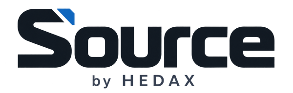
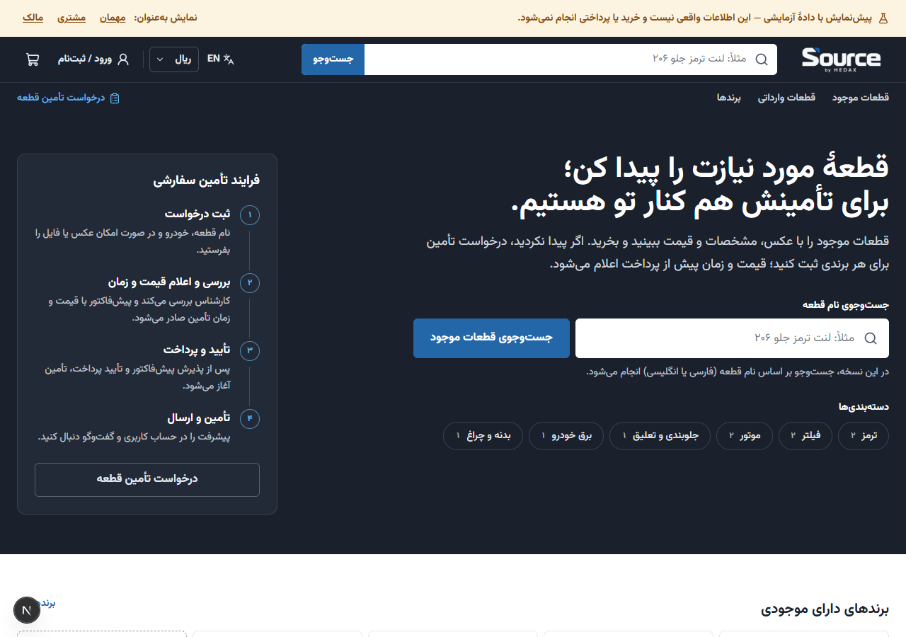

<div align="center">


# Source by HEDAX

**Auto parts commerce. Custom sourcing. One connected workflow.**

[فارسی](README.fa.md) · [Architecture](docs/ARCHITECTURE.md) · [Deployment](docs/DEPLOYMENT.md) · [Launch status](docs/DEPLOYMENT_STATUS.md)

</div>

Source connects an auto parts storefront with custom sourcing, quotations, staff operations and fulfillment. It supports Persian (RTL) and English (LTR), with shared business rules across the web application, API and background workers.

> **Pre-launch — updated 12 October 2026.** Public release and live customer/payment acceptance are not yet confirmed. See the [deployment status](docs/DEPLOYMENT_STATUS.md) before using this system for real transactions.

## Product workflows

| Workflow | Capabilities |
| --- | --- |
| Buy available parts | Catalog, Persian search, cart, inventory reservation, checkout and order fulfillment |
| Request custom sourcing | Requests for any brand, conversation and file attachments, versioned quotations, acceptance and sourcing stages |
| Operate the business | Staff roles, mandatory staff MFA, audit history, inventory imports/exports, returns and refunds |
| Produce quotations | Persian and English PDFs, IRR settlement and AED reference pricing |

These capabilities have local test coverage; live payment and SMS acceptance still require provider accounts and public-site validation. Test evidence is recorded in [TEST_REPORT.md](docs/TEST_REPORT.md).

## Architecture

| Layer | Technology | Location |
| --- | --- | --- |
| Storefront and administration | Next.js, React, next-intl | `apps/web` |
| REST API and real-time messaging | NestJS, Socket.IO, Prisma | `apps/api` |
| Jobs and PDF rendering | BullMQ, Playwright/Chromium | `apps/worker` |
| Business rules | TypeScript | `packages/domain` |
| Shared API contracts | Zod | `packages/contracts` |
| Data and queues | PostgreSQL 18, Redis 8 | `database/prisma`, `infra` |
| Upload scanning | ClamAV | `infra` |
| Deployment | Docker Compose, Caddy | `infra` |

## Local development

Use Node.js 24 (the Docker runtime) and pnpm 10.34.6. The package manifests accept Node.js 22.12 or later.

```bash
corepack enable
pnpm install --frozen-lockfile
cp .env.example .env
```

Set unique development secrets and a local database connection in `.env`, then follow the complete [Persian setup guide](README.fa.md#راه‌اندازی-محلی-بدون-docker). Never reuse development credentials in production.

```bash
pnpm db:generate
pnpm build
pnpm db:migrate:deploy
pnpm db:seed:dev
```

`db:seed:dev` is for a local development database only. Create the first owner through `owner:bootstrap` as documented in the setup guide; there is no default administrator password.

| Local page | Address |
| --- | --- |
| Storefront | `http://localhost:3000/fa` |
| Staff sign-in | `http://localhost:3000/fa/staff/login` |
| Administration | `http://localhost:3000/fa/admin` |

On Windows, the existing `scripts/local/start-local.ps1` and `stop-local.ps1` manage the local stack. See [README.fa.md](README.fa.md) for prerequisites and commands.

## Quality checks

```bash
pnpm lint
pnpm typecheck
pnpm test:unit
```

The proposed GitHub Actions workflow runs lint, type checks and domain/contracts/API unit tests on pushes and pull requests. PDF/browser tests and database integration tests have separate setup requirements; see [CONTRIBUTING.md](CONTRIBUTING.md). A configured workflow is not a claim that a run has passed.

## Documentation

| Guide | Purpose |
| --- | --- |
| [Documentation index](docs/README.md) | Find the appropriate guide |
| [Architecture](docs/ARCHITECTURE.md) | Module boundaries, data and workflows |
| [Admin guide](docs/ADMIN_GUIDE.md) | Product and operational tasks |
| [Deployment](docs/DEPLOYMENT.md) | Build, migrations, owner bootstrap and proxy setup |
| [Deployment status](docs/DEPLOYMENT_STATUS.md) | Public release status and acceptance criteria |
| [Backup and restore](docs/BACKUP_RESTORE.md) | Backup design and recovery procedures |
| [Launch checklist](docs/LAUNCH_CHECKLIST.md) | Technical and business acceptance criteria |
| [API specification](docs/api/openapi.json) | OpenAPI contract |
| [Contributing](CONTRIBUTING.md) | Branches, validation and pull requests |
| [Security](SECURITY.md) | Private vulnerability reporting and secret handling |

## Preview



*Local test preview with demonstration data; this image is not evidence of a live public deployment.*

## HEDAX projects

- [HEDAX brand guide](https://github.com/ali-hedax/brand-guide-hedax) — brand identity and usage guidance.
- [Dealership platform](https://github.com/ali-hedax/manage-dealership-platform) — dealership operations and analytics prototype.

Maintained by [Ali Hedayatshodeh / ali-hedax](https://github.com/ali-hedax). No open-source license is currently supplied; public visibility does not grant permission to redistribute the code or brand assets.
