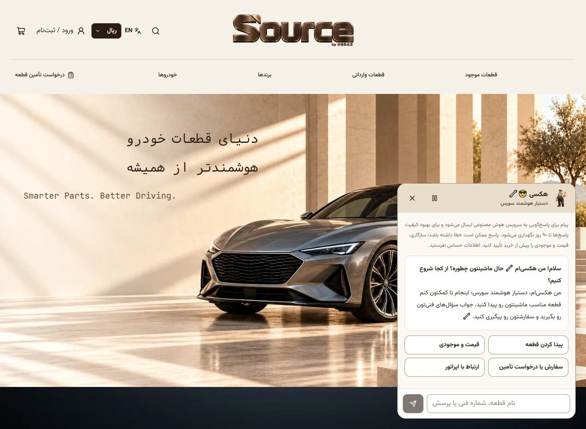
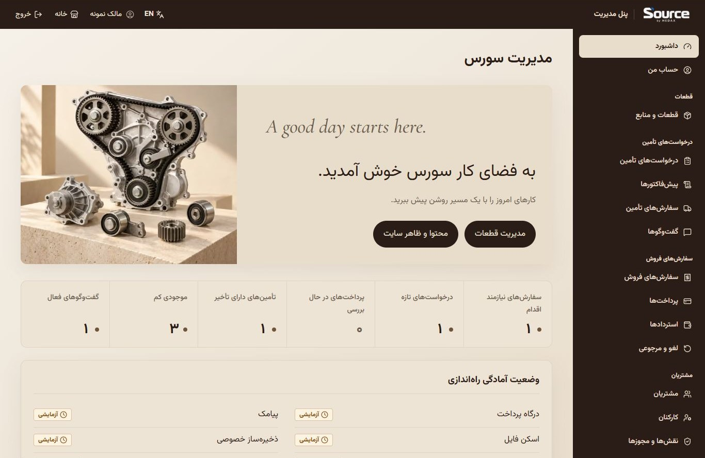

<div align="center">


### Auto parts commerce and custom sourcing in one connected workflow.

[فارسی](README.fa.md) · [Live site](https://sourcebyhedax.ir/fa) · [Architecture](docs/ARCHITECTURE.md) · [Documentation](docs/README.md) · [Launch status](docs/DEPLOYMENT_STATUS.md)

</div>

Source is an online auto parts store joined to a custom sourcing service. A customer buys a part that is in stock, or asks for one that is not; staff answer with a versioned quotation and carry the request through sourcing, payment and delivery in the same system. The interface is Persian (right-to-left) and English, and the web application, API and background workers share one set of business rules.

**Status: pre-launch.** The public site is online at [sourcebyhedax.ir](https://sourcebyhedax.ir/fa). Customer sign-in by SMS and online payment are not connected yet, so the store does not take real orders. [Launch status](docs/DEPLOYMENT_STATUS.md) lists what remains.

<p align="center">
  
  
  <br><sub>Storefront with the Hexi assistant, and the administration dashboard (demonstration data).</sub>
</p>

## What it does

| Area | Capabilities |
| --- | --- |
| Storefront | Catalog by category, brand and vehicle; Persian search; cart, inventory reservation, checkout and order tracking |
| Custom sourcing | Requests for any brand, conversation with file attachments, versioned quotations, acceptance and sourcing stages |
| Quotations | Persian and English PDFs, settlement in IRR with AED reference pricing |
| Hexi, the store assistant | Bilingual text assistant that answers from the live catalog only: part number, price, availability and recorded fitments. Daily spend and request limits; staff can read the conversations and take over |
| Messaging | Bale bot for part lookups |
| Administration | Staff roles and permissions, mandatory two-factor sign-in for staff, audit history, Excel and CSV imports with preview, returns and refunds, reports |
| Site content | Visual page builder with drafts, private preview, publish history and rollback; media library; logos, slogan, contact details and social links edited in the panel |
| Uploads | Private storage, type and size checks, and malware scanning with ClamAV before a file is released |

## Architecture

| Layer | Technology | Location |
| --- | --- | --- |
| Storefront and administration | Next.js, React, next-intl | `apps/web` |
| REST API and real-time messaging | NestJS, Socket.IO, Prisma | `apps/api` |
| Jobs and PDF rendering | BullMQ, Playwright (Chromium) | `apps/worker` |
| Business rules | TypeScript | `packages/domain` |
| Shared API contracts | Zod | `packages/contracts` |
| Data and queues | PostgreSQL 18, Redis 8 | `database/prisma`, `infra` |
| Upload scanning | ClamAV | `infra` |
| Deployment | Docker Compose, Caddy | `infra` |

Details: [architecture](docs/ARCHITECTURE.md) and [recorded decisions](docs/DECISIONS.md).

## Run locally

Requires Node.js 24 (22.12 or later also works) and pnpm 10.34.6.

```bash
corepack enable
pnpm install --frozen-lockfile
cp .env.example .env        # set development secrets and a local database connection
pnpm db:generate
pnpm build
pnpm db:migrate:deploy
pnpm db:seed:dev            # local development database only
```

| Page | Address |
| --- | --- |
| Storefront | `http://localhost:3000/fa` |
| Staff sign-in | `http://localhost:3000/fa/staff/login` |
| Administration | `http://localhost:3000/fa/admin` |

There is no default administrator password: the first owner is created with `owner:bootstrap`, as described in the [deployment guide](docs/DEPLOYMENT.md). On Windows, `scripts/local/start-local.ps1` and `stop-local.ps1` start and stop the local stack.

## Quality checks

```bash
pnpm lint
pnpm typecheck
pnpm test:unit
pnpm --filter @hedax/api build && pnpm --filter @hedax/api test:integration   # throwaway PostgreSQL
pnpm --filter @hedax/web exec playwright test                                  # browser tests on fixture data
```

CI runs lint, type checks and the unit tests on every pull request. It does not connect to production, run migrations or deploy. Results of each test run, with its date and environment, are in the [test report](docs/TEST_REPORT.md).

## Documentation

| Guide | Purpose |
| --- | --- |
| [Documentation index](docs/README.md) | Where to start, by role |
| [Architecture](docs/ARCHITECTURE.md) | Module boundaries, data and workflows |
| [Admin guide](docs/ADMIN_GUIDE.md) | Product and operational tasks in the panel |
| [Deployment](docs/DEPLOYMENT.md) | Build, migrations, owner bootstrap and proxy setup |
| [Launch status](docs/DEPLOYMENT_STATUS.md) and [checklist](docs/LAUNCH_CHECKLIST.md) | What is live and what is left before opening |
| [Backup and restore](docs/BACKUP_RESTORE.md) | Backup design and recovery procedures |
| [API specification](docs/api/openapi.json) | OpenAPI contract |
| [Contributing](CONTRIBUTING.md) · [Security](SECURITY.md) · [Support](SUPPORT.md) | Branches and reviews, private vulnerability reporting, where to ask |

Working log for contributors and coding agents: [PROGRESS.md](PROGRESS.md) and [AGENTS.md](AGENTS.md).

## HEDAX

Source is one of two HEDAX products, alongside [Manage by HEDAX](https://github.com/ali-hedax/manage-dealership-platform), the dealership operations platform. Both follow the [HEDAX brand guide](https://github.com/ali-hedax/brand-guide-hedax).

## Rights

© HEDAX. All rights reserved. No open-source license is granted; the code and the brand assets may not be redistributed. Maintainer: [Ali Hedayatshodeh](https://github.com/ali-hedax).
